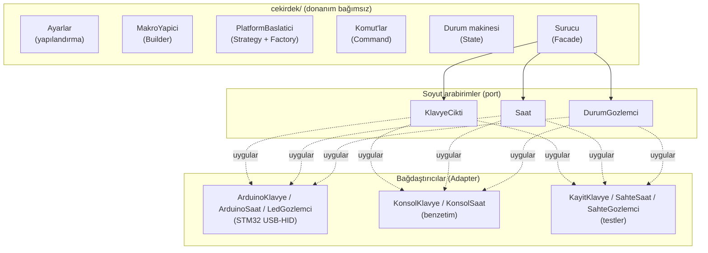
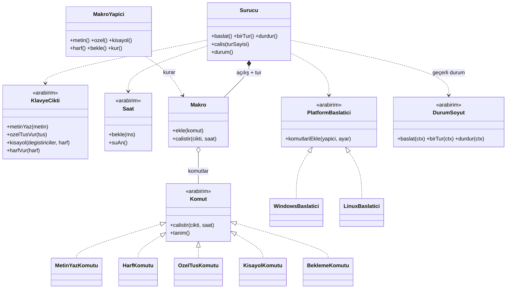
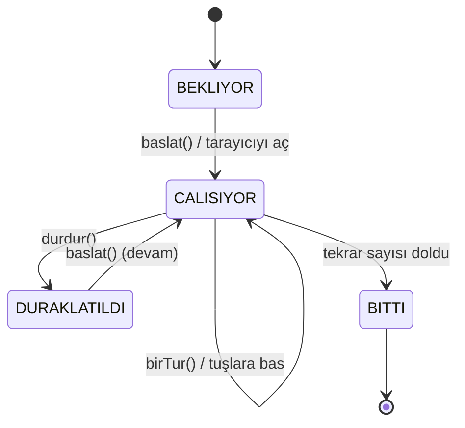
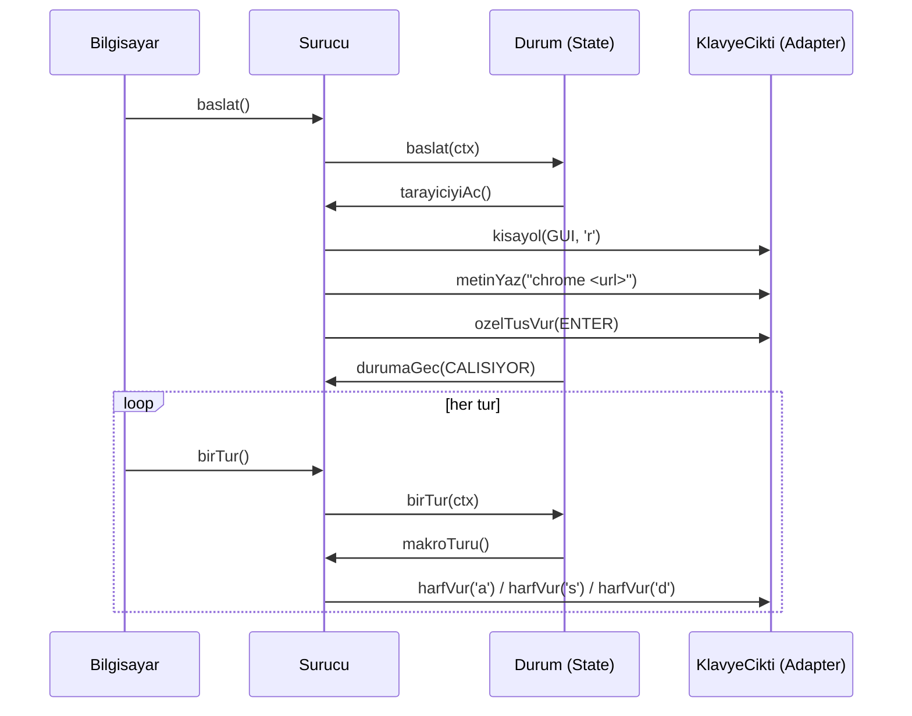

# Tasarım — USB Makro Klavye

Bu belge 2. ödevin yazılım mimarisini, uygulanan **SOLID ilkelerini** ve **GoF
tasarım desenlerini** dosya dosya anlatır. Amaç, Agora (1. ödev) ile aynı
mühendislik titizliğini bu projede de göstermektir.

## 1. Temel fikir: mantığı donanımdan ayır

Projenin kalbi tek bir karardır: **ne yapılacağı** (hangi tuşlar, hangi sırayla,
tarayıcı nasıl açılır) ile **nasıl yapılacağı** (gerçek USB sinyali, gerçek
bekleme) birbirinden ayrılır.

- **Çekirdek** (`cekirdek/`): donanım bilmeyen, saf C++ mantık.
- **Bağdaştırıcılar** (`arduino/`, `benzetim/`, `testler/`): çekirdeğin soyut
  arabirimlerini gerçek donanıma / konsola / test sahtelerine bağlar.

Bu ayrım sayesinde çekirdek, kart olmadan bilgisayarda derlenip test edilir.
*Günlük örnek:* bir kahve makinesinin "kaç ölçek, ne kadar su" mantığı ile
"ısıtıcıyı aç" elektroniği ayrı olsun ki, mantığı prize takmadan sınayabilesin.

## 2. Katmanlar



Ok yönü bağımlılığı gösterir: **her şey içeriye, soyut arabirimlere** bağlıdır;
somut donanım en dışta durur ve içeriye hiçbir şey dayatmaz.

## 3. Sınıf diyagramı (çekirdek)



## 4. Durum diyagramı (cihazın yaşam döngüsü)



`BASLATILIYOR`, `baslat()` sırasında tarayıcı açılırken yaşanan anlık evredir;
kalıcı bir durum değildir, yalnızca gözlemciye bildirilir.

## 5. Sıralı diyagram (takılınca ne olur)



## 6. SOLID ilkeleri — nerede uygulandı

| İlke | Türkçesi | Bu projede |
|---|---|---|
| **S**RP | Tek sorumluluk | Her sınıfın tek işi var: `Ayarlar` yapılandırmayı tutar/ayrıştırır, `MakroYapici` makro kurar, `PlatformBaslatici` açılış dizisini üretir, `Surucu` yalnızca akışı yönetir. |
| **O**CP | Açık/Kapalı | Yeni platform = yeni `PlatformBaslatici` sınıfı; yeni adım türü = yeni `Komut` sınıfı. Var olan kod değişmez (`baslatici.*`, `komut.h`). |
| **L**SP | Liskov yerine koyma | `KonsolKlavye`, `ArduinoKlavye`, `KayitKlavye` her yerde `KlavyeCikti` yerine sorunsuz geçer; test sahteleri bu yüzden mümkün. |
| **I**SP | Arabirim ayrımı | `KlavyeCikti` ve `Saat` ayrı, küçük arabirimlerdir. Saat isteyen kod klavye arabirimine bağlanmaz. |
| **D**IP | Bağımlılığı tersine çevirme | Üst katman `Surucu`, somut donanıma değil `KlavyeCikti`/`Saat` soyutlamalarına bağlıdır; bağımlılıklar yapıcıdan enjekte edilir. |

*DIP günlük örneği:* müdür (üst katman) işi "birine" verir; o kişinin stajyer mi
kıdemli mi olduğuna bakmaz, yeter ki "iş yapabilen" tanımına uysun. Burada o
tanım `KlavyeCikti` arabirimidir.

## 7. GoF tasarım desenleri — nerede ve neden

| Desen | Türkçesi | Dosya | Neden |
|---|---|---|---|
| **Strategy** | Strateji | `cekirdek/baslatici.*` | Tarayıcı açma dizisi Windows ve Linux'ta farklı; her biri ayrı strateji. |
| **Factory** | Fabrika | `baslaticiYap()` | Platforma göre doğru stratejiyi üretir; çağıran somut sınıfı bilmez. |
| **Command** | Komut | `cekirdek/komut.h` | Her makro adımı "kendini çalıştır" diyen bir nesne; makro bunları türünü bilmeden işler. |
| **Builder** | Yapıcı | `MakroYapici` (`cekirdek/makro.h`) | Makro adım adım, okunur akıcı arayüzle kurulur; nesne oluşturma ayrıntısı tek yerde. |
| **State** | Durum | `cekirdek/durum.*` | Cihazın her durumu ayrı sınıf; aynı isteğe duruma göre farklı tepki (if-zinciri yok). |
| **Adapter** | Bağdaştırıcı | `arduino/`, `benzetim/`, `testler/sahteler.h` | Soyut `KlavyeCikti`/`Saat`, gerçek USB-HID'ye / konsola / test sahtesine uyarlanır. |
| **Observer** | Gözlemci | `cekirdek/gozlemci.h` | Sürücü durum değişince gözlemcilere haber verir (LED, konsol log); gevşek bağ. |
| **Facade** | Cephe | `cekirdek/surucu.*` | Tüm parçaları gizleyip dışarıya küçük bir arayüz sunar: `baslat/birTur/durdur/calis`. |

## 8. Test stratejisi

- Çekirdek saf C++ olduğu için **kart olmadan** test edilir (`testler/`).
- `Saat` soyut olduğundan testler **gerçek zaman beklemeden** zamanlamayı
  doğrular: `SahteSaat` yalnızca istenen süreleri sayar.
- `KlavyeCikti` soyut olduğundan `KayitKlavye` gönderilen tuşları dizge olarak
  kaydeder; test beklenen diziyle karşılaştırır.
- Çalıştırma: `make test` (CI'da her gönderimde otomatik; `.github/workflows/odev2.yml`).

## 9. Dizin yapısı

```
odev2-usb-klavye/
├── cekirdek/     donanım bağımsız çekirdek (C++17)
├── benzetim/     konsol bağdaştırıcısı + demo (make benzetim)
├── testler/      birim testleri + sahteler (make test)
├── arduino/      STM32 (STM32duino) donanım taslağı
├── belgeler/     bu tasarım belgesi + analiz
├── ornek_ayar.conf   örnek yapılandırma
└── Makefile
```

## 10. Bilinçli kısıtlar

- Cihaz işletim sistemini **algılayamaz**; platform ayarlardan/derlemeden gelir.
- Linux'ta terminal açma kısayolu masaüstüne göre değişir, bu yüzden
  ayarlanabilir (`linux_terminal`).
- Metinden ayrıştırma (esnek yol) bilgisayar/benzetim tarafındadır; kartta
  ayarlar doğrudan koda yazılır (basit yol), böylece gömülü tarafta istisna
  (exception) yüküne gerek kalmaz.
